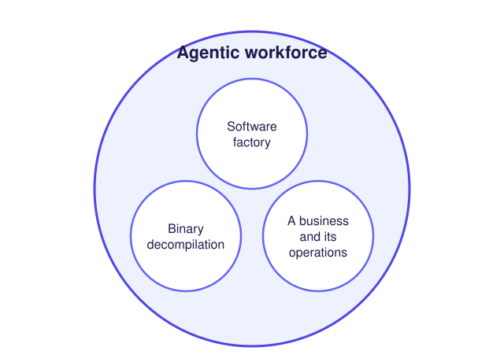

Jive is a **developer platform** and an **agentic workforce platform**. Its goal is to take the manual steps out of
building, shipping and running software, and the organizations behind it: no CI configuration to write, no packages
or accounts to create by hand, no secrets copied between systems, and no laptop that has to stay on for work to
continue.

- **Developer platform:** the `jive` CLI, the CI/CD pipeline every Jive package runs, and resource provisioning,
  which makes sure every resource a package needs exists in its organization.
- **Agentic workforce platform:** workforces of agents and code that run an organization's work. A software factory
  is one kind of workforce, binary decompilation another, a business and its operations another.

<picture>
  <source media="(prefers-color-scheme: dark)" srcset="/jive-platforms-dark.svg" />
  
</picture>

## A first look

A package gets its whole pipeline by extending an abstract. Here an npm library extends `jive-abstract-library`: its
six CI/CD scripts call the abstract's CLI, and its `jive` block says where it deploys.

```json
{
  "name": "@my-scope/my-library",
  "scripts": {
    "jive:cicd:get-config": "jive-library cicd get-config",
    "jive:cicd:build": "jive-library cicd build",
    "jive:cicd:audit": "tsc --noEmit -p tsconfig.json && bun test",
    "jive:cicd:deploy:plan": "jive-library cicd deploy-plan",
    "jive:cicd:upload-artifacts": "jive-library cicd upload-artifacts",
    "jive:cicd:deploy": "jive-library cicd deploy"
  },
  "jive": {
    "cicd": {
      "deploy": { "verb": "Publish", "branches": { "main": ["latest"] }, "previews": false, "sequentially": true },
      "runsOnPullRequests": true,
      "runsOn": "ubuntu-latest"
    },
    "library": { "daemons": [], "provisionWithJive": null }
  }
}
```

The repository's only CI file is a standard `.github/workflows/pipeline.yml` that calls Jive's shared pipeline.
Each push to `main` builds, tests and publishes the library to npm, skipping the publish when the version is already
there ([CI/CD hooks](/packages/cicd/)).

## Agentic workflows, not skills

A **skill** is instructions an agent reads: it may follow them, skip a step, or forget them after a long session, and
nothing records whether it did. An **agentic workflow** is a process defined in code. Each step is deterministic code
or a call to an agent for one bounded task. Triggers (a schedule, a commit, a message, a threshold) start it. Its state
is saved at every step, so a failed or interrupted step is retried rather than the whole run. Every step records its
start, end, outcome and cost. What must happen is enforced by the workflow, not hoped for from the agent.

So a business process in Jive is "a running, inspectable, maintainable workflow instead of a fragile chain of manual
procedures"
([architecture §3.3](https://github.com/jive-sh/jive/blob/462dff763e8194b412b3c040feeaf9f854b6a3e1/docs/jive_architecture_discussion.md#33-arbitrary-durable-workflows)).
A workforce is a set of such workflows, the agents they call, and the resource providers they act through.
*Planned:* agentic workflows as a package kind, and workforces built from them.

## A marketplace of package kinds

Everything in Jive is an npm package, and **every kind of package is itself a package**: an *abstract*,
`jive-abstract-<kind>`, implements the six CI/CD hooks for that kind, owns the config an extending package fills in,
and scaffolds new packages of the kind. Extending one gives a package a working pipeline with no CI configuration of
its own. Kinds built today include `jive-abstract-library` (npm libraries and CLIs), `jive-abstract-backend-convex`
and `jive-abstract-app-expo`. Anyone can publish an abstract, so the set of kinds grows like a marketplace
([Abstracts](/packages/abstracts/)).

**Resources** are the same idea for what packages use. A **resource provider** is one kind of outside system, such as
a package registry, offering several resource types, such as packages and orgs. An implementation is a package for one
system, such as npm. An organization configures one implementation per provider kind, and callers name only the kind:
`jive provision package-registry package @scope/name` makes sure that package exists on whichever registry the
organization uses ([Resource providers](/resources/providers/)).

## No monorepo needed

Jive began as a way to make independent repositories work like a monorepo. Each package keeps its own repository,
version and pipeline, and Jive supplies what a monorepo would:

- **One checkout for local work:** `jive init` makes any repository a workspace, and `jive load` adds repositories to
  it as submodules, all signing and pushing the same way.
- **One way to ship:** every repository runs the same pipeline through its abstract.
- **Resources instead of shared code:** a package declares the resources it needs and the organization's providers
  supply them, so nothing has to live in the same repository to work together.

## What Jive borrows from Brazil and Version Sets

Amazon builds its services with an internal system called **Brazil**, organised around many small repositories rather
than one. Public descriptions of it are second-hand: a former Amazon build-team engineer's account
([gist, 2017](https://gist.github.com/terabyte/15a2d3d407285b8b5a0a7964dd6283b0)) and
[ByteByteGo's guide](https://bytebytego.com/guides/how-does-amazon-build-system-work/). In them:

- code is broken into **packages**, each team owning its own repositories;
- a **version set** is "a list of package versions that are known to be consistent together", and every build runs
  "in a version set";
- a default version set, **live**, is where anyone publishes, and each team keeps its own version set, so "no one team
  is blocked on" another's builds;
- minor versions are non-breaking, and major versions are "picked up by request only".

Jive takes the same shape: independent packages in independent repositories and, *planned*, **version sets**: a pinned
set of package versions known to work together, built and tested as a whole before it is promoted. Today each package
pins the exact versions it builds with.

## Next

The [API reference](/reference/) covers every contract Jive's packages, CLI, daemon, extension and server agree on.
