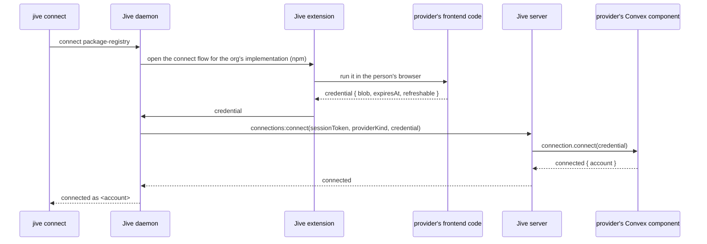

Before Jive can act on an outside system, an organization connects an account on it once. The person does only what
the outside system requires of a human. Jive brings them to the right page and moves the credential.

**Decided** (Alex, 2026-11-04): "The frontend code gets invoked by some jive extension to navigate someone to the right
screens in order to generate the credential blob, then the credential blob is handed from that code to the extension
which hands it to the daemon which hands it to jive. This implies jive has some connect API as well as an accompanying
CLI command." Not built.

## The handoffs

1. **`jive connect <provider kind>`** (**Proposed** name). The CLI asks the daemon, which holds the machine's
   session. The provider kind completes from `jive-abstract-resource-provider-*` packages, as for `provision`.
2. **The daemon to the extension.** The daemon tells the extension which implementation the organization configured.
3. **The extension runs the provider's frontend code** (`src/connect/` in the implementation, **Proposed**) in the
   person's own browser, where they are already signed in to the outside system. It opens the system's own pages, in
   order, until the system issues a credential.
4. **Back to the server.** The credential goes extension → daemon → `connections:connect` on the server
   (**Proposed** name). It never passes through the CLI.
5. **The server checks it** with the component's `connection.connect`, then stores it sealed against the
   organization. From then on, the server passes it to every call the component gets.
6. **Refresh.** Before a refreshable credential expires, the server calls `connection.refresh` and stores the new
   one. A credential that can't be refreshed shows as expiring, and the person runs `jive connect` again.

## What exists today

**Built:** the daemon side, in jive 0.8.0 and later. The extension's daemon is `jive-daemon`, the one daemon
`@jive-sh/jive` installs. Chrome starts jive's `jive-native-host` command, which relays the extension's messages to the daemon's
socket, `~/.jive/jive-daemon.sock`; at each start the daemon registers that host with Chrome and Chromium on macOS and
Linux (not yet on Windows). The extension never holds a session: it asks the daemon, which uses the session
`jive login` keeps, and can start a sign-in for it
([protocol.ts](https://github.com/jive-sh/jive/blob/fc7ac076f46e489f4028186b4ce8053e332622d9/src/modules/extension-daemon/protocol.ts)).

**Built, unpublished:** `@jive-sh/extension` exists on Alex's machine as a proof of concept, with no GitHub repository
and no release.

The protocol carries an npm credential only, and who accepts it on the Jive side isn't decided: until it is, the
daemon answers the extension that it isn't ready, so the extension stops before it changes anything on npm. So steps 2
to 4 exist for npm in prototype form, and steps 1, 5 and 6 don't exist.

## An OAuth sign-in as the credential

**Decided** (Alex, 2026-11-19): "long term jive will have an extension which obtains credentials for an individual and
the saves those credentials. seeing the token creation process versus the oauth session obtaining process an oauth
session req with one click is probably easier to automate. then the daemon grabs the session cookie or wrangler json
and passes it to jive's backend."

Where an outside system offers OAuth, the frontend code gets the credential from the system's own sign-in, not by
creating an API token:

- **Creating a token takes choices; approving a sign-in takes one click.** Cloudflare's API token page asks for a
  template, extra permissions the template lacks (D1, for a Worker that uses one) and the account. Cloudflare's OAuth
  approval page asks only for a yes.
- **The credential is refreshable.** An OAuth sign-in yields a short-lived access token and a refresh token. That
  matches the `Credential` shape on [Resource providers](/resources/providers/): `blob` holds both tokens,
  `expiresAt` is the access token's expiry, and `refreshable` is true. The server's `connection.refresh` renews it, and
  a pipeline gets a fresh access token from the server instead of a long-lived secret.
- **The device grant moves consent to any device.** With the OAuth 2.0 device authorization grant
  ([RFC 8628](https://datatracker.ietf.org/doc/html/rfc8628)), the machine that needs the credential shows a page and
  a code, and the person approves on whichever device they have: their laptop, or their phone while the laptop is
  off. Nothing needs a browser on the machine itself or a callback to its `localhost`.

**Tried by hand** (2026-11-19), as a proof of concept with Cloudflare:

1. On a cloud machine with no browser, `wrangler login --device` (Wrangler 4.151.2) printed
   `https://dash.cloudflare.com/oauth2/device/verify` and an eight-character code.
2. Alex opened the page on his own computer, entered the code, and approved for the Jive account.
3. Wrangler saved an access token, a refresh token and the access token's expiry (one hour later) in
   `~/.config/.wrangler/config/default.toml`.
4. The access token, stored as `jive-sh/skill-sync-service`'s `CLOUDFLARE_API_TOKEN` repository secret, deployed that
   Worker through its pipeline.

The access token stops working after an hour and nothing refreshes it yet, so that secret is scaffolding. In the
design above, the daemon hands the whole sign-in to `connections:connect`, the server keeps the refresh token, and
`connection.refresh` keeps the access token current. Not built.

## Open questions

- **Who builds `src/connect/` code for a system with no browser flow** (a token pasted from a settings page)?
  **Proposed:** the frontend code opens that settings page and reads the token the system displays. A person still
  never copies or pastes anything.
- **How the extension loads a provider's frontend code.** **Proposed:** the extension bundles the frontend code of
  every implementation the server has installed, and a new release ships whenever one is added. Chrome's Manifest V3
  "extensions now need to bundle all code they are using inside the extension itself"
  ([Chrome docs](https://developer.chrome.com/docs/extensions/develop/migrate/remote-hosted-code)).
