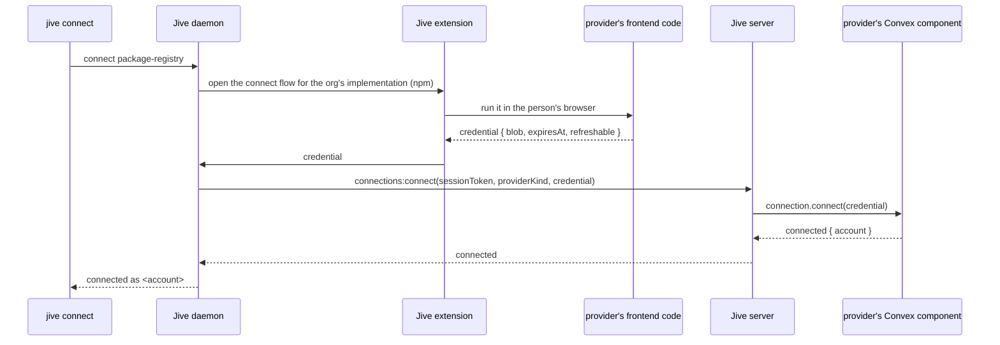

Before Jive can act on an outside system, an organization connects an account on it once. The person does only what
the outside system requires of a human. Jive brings them to the right page and moves the credential.

**Decided** (Alex, 2026-11-04): "The frontend code gets invoked by some jive extension to navigate someone to the right
screens in order to generate the credential blob, then the credential blob is handed from that code to the extension
which hands it to the daemon which hands it to jive. This implies jive has some connect API as well as an accompanying
CLI command." Not built.

## The handoffs

1. **`jive connect <provider kind>`** (**Proposed** name). The CLI asks the daemon, which holds the machine's
   session. The provider kind completes from `jive-abstract-resource-provider-*` packages, as for `provision`.
2. **The daemon to the extension.** The daemon tells the extension which implementation the organization configured.
3. **The extension runs the provider's frontend code** (`src/connect/` in the implementation, **Proposed**) in the
   person's own browser, where they are already signed in to the outside system. It opens the system's own pages, in
   order, until the system issues a credential.
4. **Back to the server.** The credential goes extension → daemon → `connections:connect` on the server
   (**Proposed** name). It never passes through the CLI.
5. **The server checks it** with the component's `connection.connect`, then stores it sealed against the
   organization. From then on, the server passes it to every call the component gets.
6. **Refresh.** Before a refreshable credential expires, the server calls `connection.refresh` and stores the new
   one. A credential that can't be refreshed shows as expiring, and the person runs `jive connect` again.

## What exists today

**Built, unpublished:** `@jive-sh/daemon` and `@jive-sh/extension` exist on Alex's machine as a proof of concept
(no GitHub repository). Chrome starts `jive-native-host`, which relays the extension's messages to the daemon's socket.
Their protocol carries an npm credential only, and the step that hands it to the server isn't decided. So steps 2 to 4
exist for npm in prototype form, and steps 1, 5 and 6 don't exist.

## Open questions

- **Who builds `src/connect/` code for a system with no browser flow** (a token pasted from a settings page)?
  **Proposed:** the frontend code opens that settings page and reads the token the system displays. A person still
  never copies or pastes anything.
- **How the extension loads a provider's frontend code.** **Proposed:** the extension bundles the frontend code of
  every implementation the server has installed, and a new release ships whenever one is added. Chrome's Manifest V3
  "extensions now need to bundle all code they are using inside the extension itself"
  ([Chrome docs](https://developer.chrome.com/docs/extensions/develop/migrate/remote-hosted-code)).
